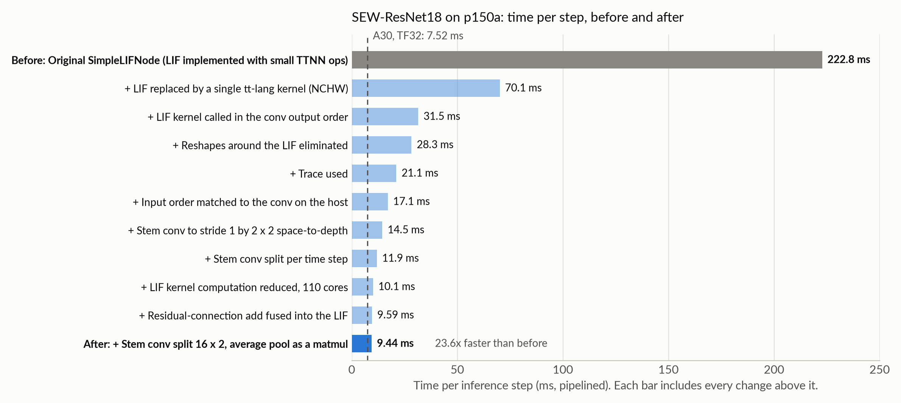
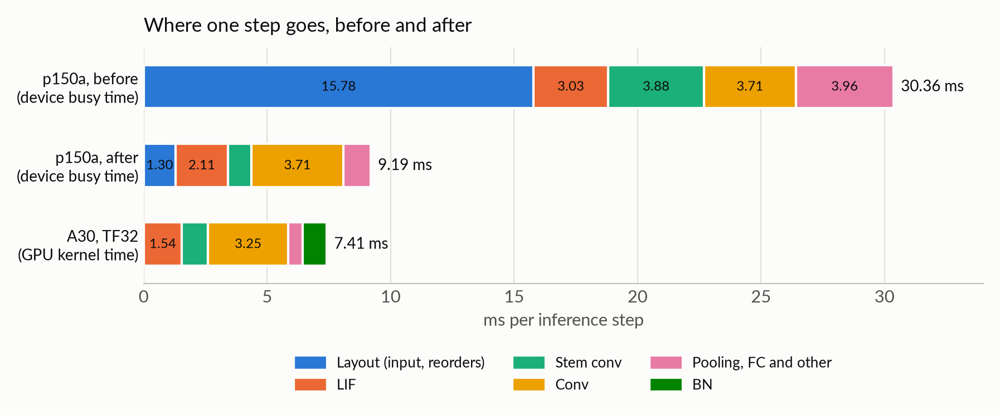

# Spiking ResNet on Tenstorrent

[日本語](README_ja.md)

A record of running the SpikingJelly 2.0 [1] implementation of SEW-ResNet18 [2] on a Tenstorrent Blackhole p150a and making it fast. The
model is compiled with tt-xla [3] (torch_xla and the `pjrt-plugin-tt` PJRT plugin); only the LIF neuron is replaced, by a
kernel written in tt-lang [4].

- One inference step (T = 4 time steps) went from 222.8 ms to 9.44 ms
- An NVIDIA A30 (TF32) takes 7.52 ms for the same step; the p150a takes 1.26 times as long.
- There is, however, still much room for optimization on the p150a. A lower-bound estimate from DRAM bandwidth, with
  the current set of ops each using the DRAM bandwidth to the full, is about 4.8 ms (computed with the measured
  bandwidth for mixed reads and writes, about 390 GB/s; about 3.7 ms with the specified 512 GB/s), so the execution
  time could drop to about half of what it is now. For example, the convs and the linear
  layer have no kernel optimization yet and are left to the compiler.

<picture>
  <source media="(prefers-color-scheme: dark)" srcset="docs/figures/step-times-dark.png">
  
</picture>

The gray bar is before, the dark blue bar is after all changes. Each bar in between includes every change above it.

## Motivation, method and scope

The Tenstorrent Blackhole architecture is a many-core AI accelerator with distributed memory, whose cores are laid
out in a grid and connected by a 2D torus network-on-chip (two NoCs). In this respect it resembles Intel's
neuromorphic processors Loihi [5] and Loihi 2 [6]. We therefore expected it to suit spiking neural networks (SNNs), and
started by speeding up SEW-ResNet, one of the best-known models implemented in SpikingJelly, one of the most widely
used SNN libraries.
Apart from a dedicated fused kernel for the Leaky Integrate-and-Fire neuron, we aimed to rely as far as possible only
on the optimizations of tt-xla, the standard machine-learning framework compiler for Tenstorrent hardware. We did,
however, rewrite parts of the model on the PyTorch side (converting the stem conv by space-to-depth and splitting it, replacing the average
pool with a matmul, changing tensor layouts) and preprocess the input on the host.
Tenstorrent provides skills [7] that support optimization by agents; we had Opus 5.5 use them in Claude Code and worked
on the speed-up semi-automatically.
This is a test of how well performance engineering by an agent works for implementing SNNs on the Tenstorrent
Blackhole p150a, so a rigorous comparison with other computing platforms is not intended at this point.
There should be SNN configurations better suited to judging how well Tenstorrent hardware fits SNNs, but since we are
testing with a well-known model first, we make no claim about that either.

## Results

Conditions: SEW-ResNet18 (ADD residual connections), 224 x 224 input, batch 8, T = 4, fp32, BatchNorm in inference
mode.

- Pipelined: k steps are sent back to back and waited for once; the time is converted to one step.
- Synced: the logits are transferred to the host after every step.

| Change | Pipelined | Synced |
| --- | --- | --- |
| Original `SimpleLIFNode` (the LIF was implemented with small TTNN [8] ops) | 222.8 ms | 255.8 ms |
| LIF replaced by a single tt-lang kernel (called in the dimension order of the BN output, NCHW) | 70.1 ms | 85.7 ms |
| LIF kernel called in the dimension order of the conv output | 31.5 ms | 43.0 ms |
| Reshapes around the LIF eliminated; the layer4 LIF takes input of shape `[1, T, R, C]` | 28.3 ms | 34.6 ms |
| Trace used | 21.1 ms | 27.2 ms |
| Input dimension order matched to the conv on the host | 17.1 ms | 22.7 ms |
| Stem conv converted to a stride-1 conv by 2 x 2 space-to-depth | 14.5 ms | 19.6 ms |
| Stem conv split per time step; the following LIF loads its outputs directly | 11.9 ms | 17.3 ms |
| Computation in the LIF kernel reduced; cores in use increased to 110 | 10.1 ms | 15.5 ms |
| Residual-connection add fused into the LIF | 9.59 ms | 14.2 ms |
| Stem conv split into 16 images x 2; average pool replaced by a matmul | **9.44 ms** | 15.0 ms |
| (reference) A30, TF32 and `cudnn.benchmark` | 7.52 ms | 7.63 ms |
| (reference) A30, strict fp32 as in SpikingJelly's benchmark | 14.75 ms | — |

Where the time of one step goes, before and after:

<picture>
  <source media="(prefers-color-scheme: dark)" srcset="docs/figures/breakdown-dark.png">
  
</picture>

The "before" bar is the first stage at which the breakdown was measured: the LIF as a kernel, called in the dimension
order of the conv output (the third row of the table; re-measured at 31.39 ms per step). The original `SimpleLIFNode`
stage (222.8 ms) was bound by host dispatch, and its breakdown was not measured by replaying the IR.

The p150a values are device busy times measured by replaying the TTNN IR written by tt-xla op by op (after: sum 9.19
ms, the step takes 9.44 ms; before: sum 30.36 ms). The replay used the tt-metal in a container, which is a different version from the one tt-xla
uses, so treat these as estimates. The A30 values are GPU kernel times from torch.profiler (sum 7.41 ms; the step takes
7.52 ms). On the p150a, the BNs are folded into the convs and the residual adds are fused into the LIF.

### Reading the results

- Speed only. The weights are the initial ones and the inputs are random, as in SpikingJelly's benchmark; accuracy
  with trained weights was not evaluated
- Correctness was checked against the CPU in the same process, layer by layer. For changes that should not alter the
  math (removing reorders, splitting, fusing), the logits were checked to stay bit-identical
- The conv outputs on the p150a carry about 10 mantissa bits, so spikes near the threshold flip. When the LIF kernel
  was introduced, the device logits correlated with the CPU logits at 0.911 (0.908 for the original `SimpleLIFNode` on
  the device). CPU-only runs with rounding-sized noise added to the layer outputs level off at about 0.92
- The later changes do some preprocessing on the host: reordering the input, padding channels with zeros, space-to-depth,
  and splitting per time step (about 6.6 ms under trace). That time is not included in the p150a values
- The A30 values come from the same model built the same way (the LIF is SpikingJelly's `LIFNode`, which runs as a
  Triton kernel on the A30). SpikingJelly's benchmark itself disables TF32, so both values are shown
- Versions: `pjrt-plugin-tt` 1.4.0 (with its bundled tt-lang 1.1.5), torch 2.11.0, torch-xla 2.9.0, p150a firmware
  19.15.0. Some of the constraints in this README and in `docs/ja/discrepancies.md` are specific to these versions

## What we found

- Before trace, the step time was set by the host sending operations to the device one by one. That costs about
  70–360 µs per operation, 12–72 times the A30's
- Writing a neuron as element-wise ops takes about 7 ops per layer per time step, which made the LIF the largest
  source of operations. The first thing to do is to make each neuron layer one kernel
- After trace, the busy time from replaying the IR op by op predicted the real time well (9.19 ms vs 9.44 ms). The
  next change can be chosen from that breakdown
- On the device, reorders (`reshape`, `permute`, `to_layout`) took longer than the convs at first. Reordering a shape
  that is not a multiple of the 32 x 32 tile costs about 1 ms each time. Calling the neuron kernel on the layout of
  the ops around it removes the reorders
- Spikes are 0 or 1 and the SEW sums are small integers, so they are exact in any precision. As a result, fusing the
  residual add into the LIF and computing the average pool as a matmul with a 0/1 matrix left the logits bit-identical
- With the reorders gone, conv and LIF remain. The convs other than the stem take about as long as on the A30 (TF32),
  and the LIF is close to the DRAM bandwidth limit. In the IR replay, keeping the activations in L1 cut the busy time
  by about 1.9 ms, but tt-xla 1.4.0 offers no way to request that

## Reproducing the best configuration

Environments are described in `docs/ja/setup.md`. Paths are written as environment variables.

| Variable | Contents |
| --- | --- |
| `$VENV_XLA140` | Python 3.12 venv with `pjrt-plugin-tt==1.4.0`, torch-xla 2.9.0 and SpikingJelly 2.0.0 (installed with `--no-deps -e`) |
| `$UV_PY312_LIB` | The `lib` directory of the uv-managed Python 3.12, needed by torch_xla to find libpython |
| `$VENV_A30` | Venv with torch 2.11.0+cu128 and SpikingJelly 2.0.0 |
| `$DATA` | Output directory |

```bash
# p150a: 20 pipelined steps, batch 8, T = 4, 224 x 224, optimization level 1, trace
NEURON=ttl LIF_LAYOUT=nhwc4 BN=eval STEM_PAD=32 STEM_FOLD=1 STEM_SPLIT=2 STEM_LIF4=1 INPUT_LAYOUT=nhwc \
LIF_GRID=11,10 LIF_RES=1 AVGPOOL=matmul WAIT=cpu LD_LIBRARY_PATH=$UV_PY312_LIB \
  $VENV_XLA140/bin/python -I tools/xla-sew18.py compile 8 4 20 224 1 trace

# A30 reference (TF32, cudnn.benchmark)
CUDA_VISIBLE_DEVICES=0 TF32=1 CUDNN_BENCH=1 BN=eval $VENV_A30/bin/python -I tools/a30-sew18.py LIFNode 8 4 224 30
```

In both measurements the host threads were pinned to the NUMA node of the card. The p150a values are the median of
three runs.

## Files

| Path | Contents |
| --- | --- |
| `tools/ttl_lif.py` | The multi-time-step LIF kernels in tt-lang (`make_lif`, `make_lif4`, `make_lif2`, `make_lif_add`, `make_lif_nchw`) |
| `tools/xla-sew18.py` | Runs and times SEW-ResNet18 on the p150a through tt-xla; every change in the table is an environment variable |
| `tools/a30-sew18.py`, `tools/a30-sew18-profile.py` | Times the same model on the A30, and its per-layer GPU time |
| `tools/ttnn-replay-ir.py`, `tools/ttnn-replay-chain.py` | Replay the TTNN IR written by tt-xla op by op (or chained, with L1 placement) under the device profiler |
| `tools/breakdown-sew18.py`, `tools/chain-csv.py` | Per-category and per-layer breakdowns and lower bounds |
| `tools/ttl-lif-bench.py` | Device time of the LIF kernels on the SEW-ResNet18 shapes |
| `tools/xla-op-hostcost.py`, `tools/thread-sampler.py` | Measure the host cost per operation; record per-thread CPU frequency while waiting |
| `tools/lif-d22-emul.py`, `tools/xla-conv-check.py`, `tools/xla-stem-pad.py`, `tools/xla-bn-eval.py`, `tools/xla-op-backward.py`, `tools/sj_xla.py` | Reproducers and workarounds for the constraints in `discrepancies.md` |
| `docs/ja/` | Notes (Japanese) |
| `docs/figures/` | Figures in this README |

## Notes

`docs/ja/` holds three documents (in Japanese):

- `speedup-guide.md`: how to approach speeding up another SNN; what worked and what did not
- `discrepancies.md`: assumptions that turned out wrong, toolchain constraints and bugs (D1–D32)
- `setup.md`: environments, script reference, the equations of the LIF kernel

S-numbers in the notes and code comments refer to entries of our lab notebook, which is not published.

## Next

We plan to move on to a more neuromorphic way of implementing SNNs on Blackhole: weights, membrane potentials and
spikes stay in the Tensix cores' L1, and all cores synchronize once per time step.

## Related work

For Tenstorrent hardware, a public repository is writing SNN kernels in TT-Metalium (PLIF and ALIF neurons, a diagonal
SSM recurrence and more; early development) [9]. On another many-core AI accelerator with distributed SRAM, Graphcore's
IPU, SNN training has been accelerated [10][11].

## References

1. W. Fang et al., "SpikingJelly: An open-source machine learning infrastructure platform for spike-based intelligence," *Science Advances*, 9(40), eadi1480, 2023. https://doi.org/10.1126/sciadv.adi1480 / Repository: https://github.com/fangwei123456/spikingjelly (2.0.0 was used)
2. W. Fang, Z. Yu, Y. Chen, T. Huang, T. Masquelier, Y. Tian, "Deep Residual Learning in Spiking Neural Networks," NeurIPS 2021. https://arxiv.org/abs/2102.04159
3. Tenstorrent, tt-xla. https://github.com/tenstorrent/tt-xla
4. Tenstorrent, tt-lang. https://github.com/tenstorrent/tt-lang
5. M. Davies et al., "Loihi: A Neuromorphic Manycore Processor with On-Chip Learning," *IEEE Micro*, 2018. https://doi.org/10.1109/MM.2018.112130359
6. G. Orchard et al., "Efficient Neuromorphic Signal Processing with Loihi 2," IEEE Workshop on Signal Processing Systems (SiPS), 2021. https://doi.org/10.1109/SiPS52927.2021.00053
7. Tenstorrent, skills. https://github.com/tenstorrent/skills
8. Tenstorrent, tt-metal (TT-Metalium, TT-NN). https://github.com/tenstorrent/tt-metal
9. RichardMiller90, tt-snn-kernels. https://github.com/RichardMiller90/tt-snn-kernels
10. J. Finkbeiner, T. Gmeinder, M. Pupilli, A. Titterton, E. Neftci, "Harnessing Manycore Processors with Distributed Memory for Accelerated Training of Sparse and Recurrent Models," AAAI 2024. https://arxiv.org/abs/2311.04386
11. P.-S. V. Sun et al., "Exploiting deep learning accelerators for neuromorphic workloads," *Neuromorphic Computing and Engineering*, 4(1), 014004, 2024. https://doi.org/10.1088/2634-4386/ad2373

## License

Apache-2.0 (see `LICENSE`). The scripts use SpikingJelly, tt-xla, tt-lang and TT-NN, which are also Apache-2.0 and are
not included here.

## Citation

See `CITATION.cff`.
